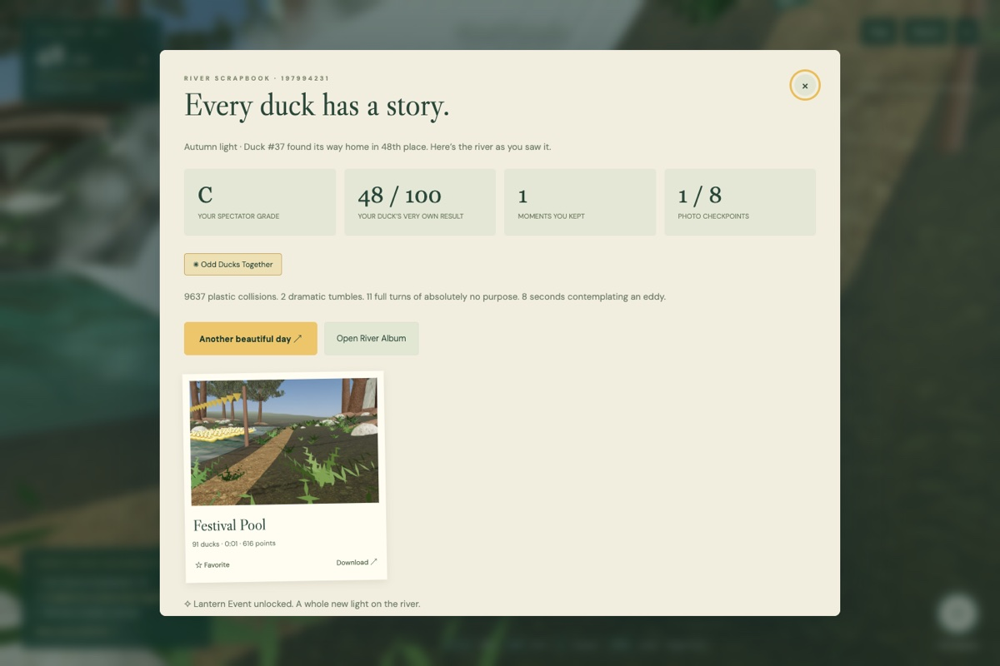

# Rubber Duckie River Race



A playable Three.js wilderness spectator race. Choose one of 100 ducks, walk the riverbanks, take live photographs, predict the fork, and keep a persistent scrapbook. Player input has no path into duck physics.

```sh
npm install
npm run dev
```

Open **http://127.0.0.1:5180**. `npm run build` makes a standalone static site in `dist/`. `npm test` runs the headless simulation and scoring checks.

## Controls

| Input | Action |
| --- | --- |
| WASD / arrow keys | Walk |
| Shift | Sprint |
| Drag landscape / double-click | Look / capture mouse |
| Space | Jump |
| C | Raise the live camera |
| Mouse wheel | Zoom while camera is raised |
| F / shutter button | Photograph |
| M | Trail map |
| P | Prediction |
| H | Tracker toggle (except Mystery Duck) |
| Escape | Close field notes / release mouse |

Touch controls and drag-to-look are available on small screens. Photos and progress are stored **locally in this browser**, using IndexedDB and localStorage. Photos can be favorited and downloaded. No account, server, API key, or AI image service is needed at runtime.

## Implemented

- Fixed-step, seeded, two-dimensional duck simulation; identical competitive hulls; stable collision order; interpolated finish timestamps.
- 720 m descending river with two cascades, an island fork, time-varying eddies, boulders, eight photo landmarks, two bridges, and hidden overlooks.
- Three.js WebGL 2 rendering, planar scene reflections, Poseidon optical coefficients, depth/current-driven surface detail, foam advection, ballistic spray, HDR environment, scanned bark/ground/rock/needle materials, instanced Dryad forest.
- Walking/sprinting/jumping with riverbank restriction; no duck interaction.
- Live camera capture, geometric scoring and occlusion checks, persistent actual-image album, favorites, downloads, race scrapbooks, Duck Book, wildlife journal, exploration, predictions, stamps, ribbons, and spectator grades.
- Classic, Daily, Mystery, Storm, 150-duck Derby, and unlockable Lantern event. Daily seeds use the UTC date. Previous same-seed traversal is shown as a ghost.
- Optional flow vectors and render/physics diagnostics in Settings.

## Build status

This is a **playable first implementation**, not completion of every v2 production acceptance gate. In particular, the flow field is a reduced hydraulic model, not a mass-conserving shallow-water solver or SPH. The renderer uses Poseidon's measured optics helper, not its WebGPU FFT engine. The course is 720 m rather than the planned folded 1.5–2 km; tree geometry is procedural, and the wildlife/ducks are original primitives. Third-person rigging/Mixamo, scanned hero redwoods, genuine three-channel forks, additional river maps, full trail shortcut topology, GPU fluid simulation, and production-grade streaming remain unimplemented. See [the acceptance audit](docs/ACCEPTANCE.md).

The original design documents are preserved alongside the application.

## Validation

`npm test` checks full-run determinism, presentation isolation, cosmetic fairness, finite-state completion across seeds and formats, both waterfall crossings, fork use, deterministic scoring, and spectator grade independence.

`node scripts/browser-check.mjs` checks the menu, live race, shutter, and saved album. `node scripts/full-playtest.mjs` covers prediction, live capture, favorites, scenic views, finish scrapbook, reload persistence, and mobile layout. These scripts currently use the installed Brave executable on macOS; adjust `executablePath` for another machine.

The development-only `?test=1` harness permits headless time advancement and scenic camera fixtures. Vite removes the harness from production builds. It is not a gameplay control.

## Attribution

Built with Three.js, Owen Yuwono's Dryad and Poseidon optical helper, and CC0 assets from Poly Haven. See [ATTRIBUTIONS.md](ATTRIBUTIONS.md) and [the asset manifest](src/assets/manifest.json).

## License

Code: MIT (see `LICENSE`). Original procedural assets: CC BY 4.0 (see
`ASSET-LICENSE.md`). Third-party components: see `THIRD_PARTY.md`.
